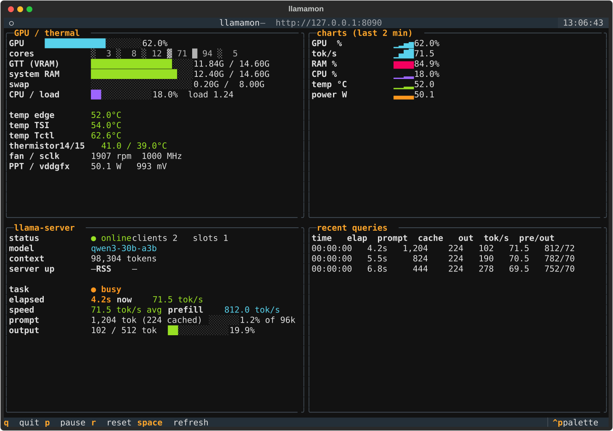

# llamamon

**Version 1.1.0**

A live terminal monitor for a local [`llama-server`](https://github.com/ggml-org/llama.cpp),
built for small boxes that run the model on the GPU of the same machine: an AMD
APU (unified memory), a single dedicated GPU, or a mini-PC. It shows in one
screen what `llama-server` is doing right now and what the hardware is doing
while it does it — in the spirit of `nvtop`, with the statistics that matter for
an inference server added: tokens/s, prefill rate and query latency.



```
 GPU / thermal                                     llama-server
  GPU (busy% / busiest core) ██████░░░░░  62.0%     status   ● online  clients 2  slots 1
  cores   ░ 12 ▓ 71 █ 94 ░  8 ...                    model    qwen3-30b-a3b
  GTT (VRAM)  ████████████████░░░░░░ 11.84G / 14.60G context  98,304 tokens
  system RAM  ███████████████████░░░ 12.4G / 14.6G   server up 3h12m  RSS 1.9G
  swap        ░░░░░░░░░░░░░░░░░░░░░░  0.2G / 8.0G
  CPU / load  ██░░░░░░░░░░░░░░░░░░░░  18%  load 1.2   task     ● busy  4.2s
                                                     tok/s    71.5   prefill 812
  temp edge  52.0°C   Tctl 62.6°C                    prompt   1,204 tok (224 cached)
  fan 1907 rpm   sclk 1000 MHz                       output   102 / 512 tok
  PPT 50.1 W   vddgfx 993 mV
```

## What it shows

| Panel | Contents |
| --- | --- |
| **GPU / thermal** | GPU busy (driver value, or the busiest CPU core when the driver has none — normal on APUs), per-core load, GTT/VARM usage, system RAM and swap, CPU and load average, edge/Tctl/TSI temperatures, fan rpm, shader clock, package power |
| **llama-server** | online/offline, model, context size, server uptime and RSS, client count, the task being processed with elapsed time, instantaneous tok/s and prefill rate, prompt/cache fill, output progress |
| **charts** | sparklines over the last 2 minutes: GPU, tok/s, RAM, CPU, temperature, power |
| **recent queries** | the last finished queries with elapsed time, prompt, cache, output, tok/s and prefill/generation split |

Keys: `q` quit, `p` pause, `r` reset history, `space` refresh.

## Install

Requires Python 3.9+ on the machine where `llama-server` runs, and
[`lm-sensors`](https://github.com/lm-sensors/lm-sensors) for the temperatures and
fan the GPU driver does not expose (`apt install lm-sensors`).

```sh
git clone https://github.com/WaarlandIT/llamamon.git
cd llamamon
./install.sh                 # venv in ~/.venvs/llamamon, command in ~/.local/bin
llamamon --version
```

`install.sh` honours `LLAMAMON_VENV` and `LLAMAMON_BIN` if you want the venv or
the command somewhere else. Manual install, if you prefer:

```sh
python3 -m venv ~/.venvs/llamamon
~/.venvs/llamamon/bin/pip install .
~/.venvs/llamamon/bin/llamamon
```

## Usage

```sh
llamamon                                  # auto-detects the port llama-server listens on
llamamon --url http://192.0.2.10:8090     # another host or port
llamamon --interval 0.5                   # sample twice per second
llamamon --stats                          # summary of the query log, no UI
llamamon --stats --since 24               # only the last 24 hours
```

| Variable | Default | Meaning |
| --- | --- | --- |
| `LLAMA_URL` | *(auto)* | llama-server base URL; without it llamamon uses the first of 8080/8090 that accepts a connection |
| `LLAMAMON_INTERVAL` | `1.0` | seconds between samples |
| `LLAMAMON_HISTORY` | `~/.llamamon-history.jsonl` | query log |
| `LLAMAMON_SENS_CHIP` | *(any)* | chip to take the fan and board thermistors from, e.g. `nct6686` |
| `LLAMAMON_SENS_TSI` | `AMD TSI` | label of the GPU/SoC secondary temperature |
| `LLAMAMON_SENS_TCTL_CHIP` | *(any)* | chip to take `Tctl` from, e.g. `k10temp` |

The sensor variables are the only board-specific part. Run `sensors -j` once and
set them if the automatic choice picks the wrong label; anything that is not
found is simply left out of the panel, so the tool works unchanged on a machine
it has never seen.

`llama-server` needs no special flags: the tool reads `/props` and `/slots`.

## Query log

Every finished query is appended to `~/.llamamon-history.jsonl` (override with
`LLAMAMON_HISTORY`), one JSON object per line:

```json
{"ts": 1795610524.98, "duration": 4.0, "prompt": 259, "cache": 0, "out": 235, "prefill_s": 24.0, "gen_s": 71.3}
```

`llamamon --stats` turns that into p50/p90/max of latency and tok/s, plus a
per-hour breakdown, so you can see how the machine behaved while the monitor was
closed. The file is capped at 20,000 lines and trimmed automatically.

## How the numbers are read

Everything is read from the local machine — no agent, no exporter, no network
access besides the `llama-server` API on your own host.

- **llama-server**: `/props` for model and context, `/slots` for
  `n_prompt_tokens`, `n_prompt_tokens_processed`, `n_prompt_tokens_cache`,
  `next_token[].n_decoded` and `id_task`. tok/s and prefill rate are deltas
  between two samples; the per-query tok/s in the log is averaged over the
  generation.
- **GPU**: `/sys/class/drm/card*/device/` for `gpu_busy_percent`,
  `mem_info_gtt_*`, `mem_info_vram_*`, `pp_dpm_sclk`, and the `amdgpu` hwmon for
  edge temperature, power and vddgfx.
- **Temperatures, fan, RAM**: `sensors -j`, `/proc/meminfo`, `/proc/stat`.
- **Server process**: found through the socket it listens on (works without
  root), then `/proc/<pid>/smaps_rollup` for RSS, with `/proc/<pid>/status` as
  fallback when that is not readable.

On AMD APUs there is no `gpu_busy_percent`; the busiest CPU core is used as a
proxy, which is a good indication there because the GPU sits on the same die.

## Development

```sh
python3 -m venv .venv && .venv/bin/pip install -e ".[test]"
.venv/bin/python -m pytest -q
```

The tests cover the pure logic (`derive_slots`, sparklines, the query log);
nothing in them needs a GPU, `sensors`, or a running `llama-server`.

## Changelog

| Version | Changes |
| --- | --- |
| 1.1.0 | Port detection when `LLAMA_URL` is unset; the panel shows the URL it polls. |
| 1.0.0 | First release: GPU/thermal panel, llama-server panel with tok/s, prefill and latency, 2-minute charts, query log with `--stats`. |


This program runs as a service on machines people reach over a network, which is
exactly the case the AGPL's network clause covers: if you run a modified version
and let others use it over the network, you have to offer them its source. Use it
internally, commercially or unsupported — all fine; just keep the source
available to the people who talk to it.

The README screenshot is rendered from fixture data by `mk_screenshot.py`; no GPU
or running server is needed to reproduce it.

## Licence

AGPL-3.0-or-later; the full text is in [LICENSE](LICENSE). llamamon is meant to
be run as a monitoring service next to llama-server, so the network clause
applies: if you run a modified version and let others use it over a network, you
have to offer them the source.

## Credits

Built by [WaarlandIT](https://waarland.it). The interface follows the example of
[`nvtop`](https://github.com/Syllo/nvtop): the numbers you need at a glance, no
dashboard to open.
